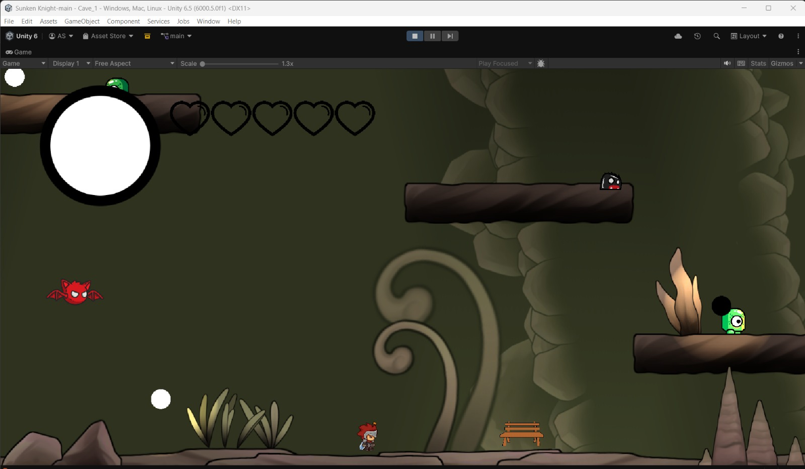
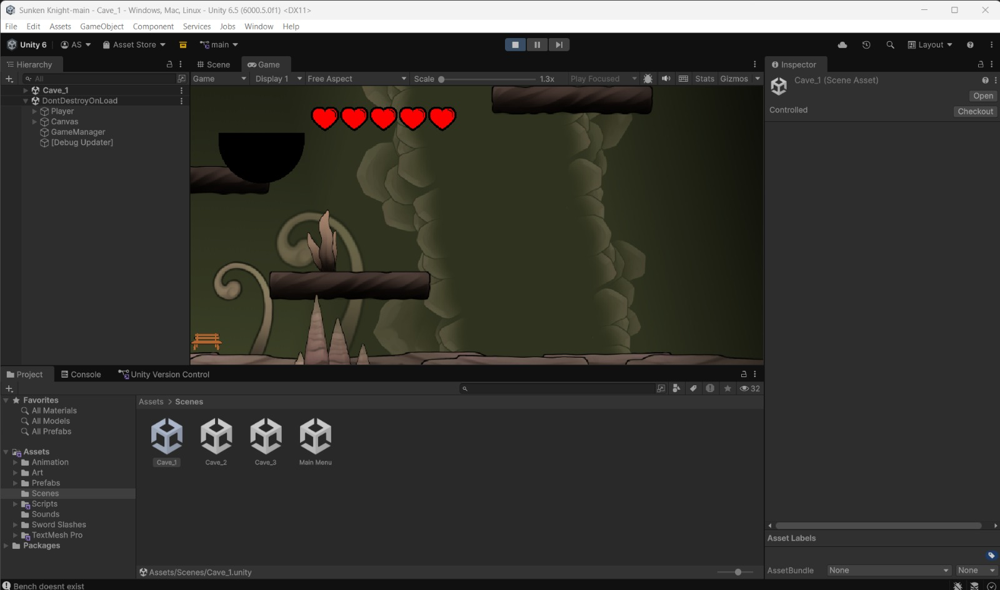

# ⚔️ Sunken Knight

A 2D Metroidvania action-platformer built in **Unity**. Explore a sunken, interconnected world, battle its creatures, and uncover new abilities that open up paths you couldn't reach before.


---

## 🎮 About the Game

Sunken Knight follows a lone knight descending into the ruins of a drowned kingdom. Like classic Metroidvanias, the world is a single connected map: areas that seem blocked at first become reachable as you gain new abilities, rewarding exploration and backtracking.

## ✨ Features

- **Interconnected world** – explore a non-linear map with hidden paths and secrets
- **Melee combat** – fight enemies with responsive attack and movement controls
- **Ability progression** – unlock new movement skills that open up previously unreachable areas
- **Enemies & bosses** – [describe your enemy types / boss fights]
- **Smooth platforming** – [e.g. wall jumping, dashing, double jump]
- [Add any other features: save points, health upgrades, map system, etc.]

## 🕹️ Controls

| Action  | Key            |
|---------|----------------|
| Move    | A / D or ← / → |
| Jump    | Space          |
| Attack  | [Key]          |
| Dash    | [Key]          |
| Pause   | Esc            |

## 📸 Screenshots

| | |
|---|---|
|  |  |

## 🛠️ Built With

- **Unity** [version, e.g. 2022.3 LTS]
- **C#**
- [Any other tools: Aseprite, Tiled, Cinemachine, etc.]

## 🚀 Running the Project

1. Install **Unity Hub** and Unity **[your version]**.
2. Clone this repository:
   ```
   git clone https://github.com/atharvasapre07/SunkenKnight.git
   ```
3. Open Unity Hub → **Add** → select the cloned folder.
4. Open the project, load the main scene from `Assets/Scenes/`, and press **Play**.

> The first time you open the project, Unity will rebuild the `Library` folder, which can take a few minutes.

## 📌 Status

[Completed / In development – e.g. "Playable demo with X areas and Y bosses."]

## 👤 Author

**Atharva Sapre** – [GitHub](https://github.com/atharvasapre07)
